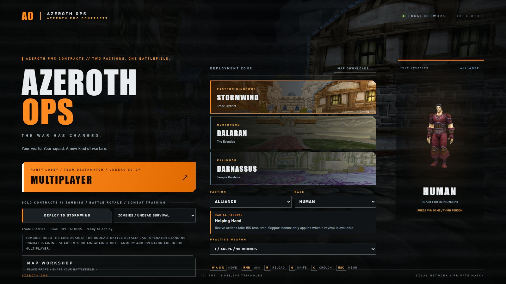
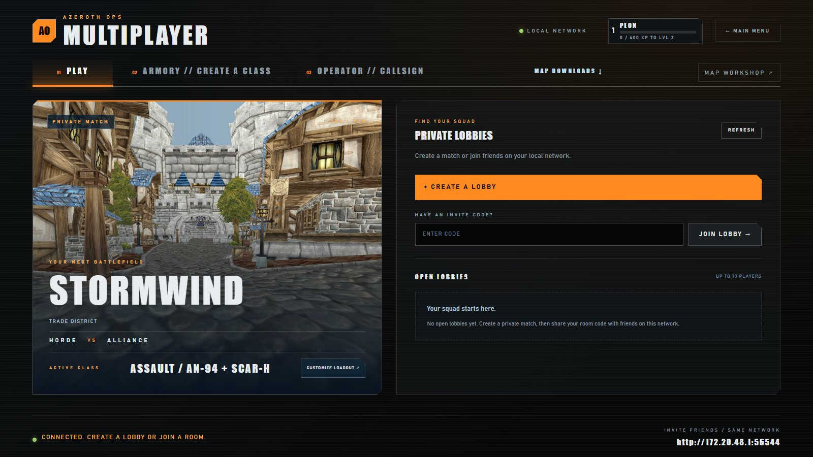
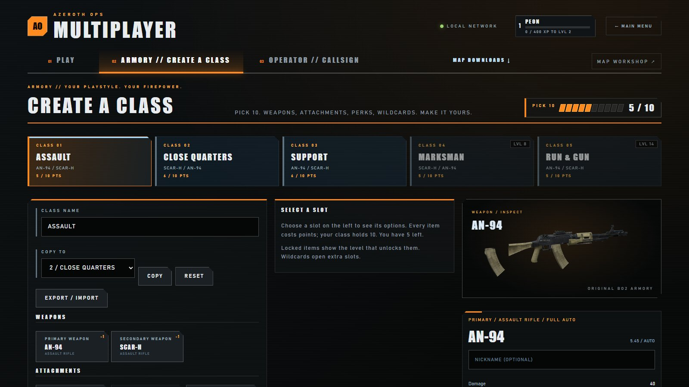
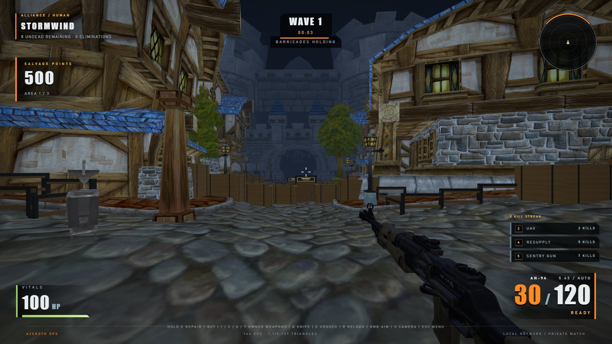
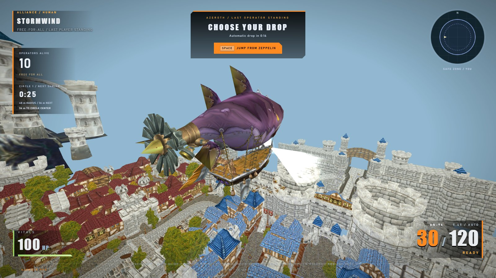
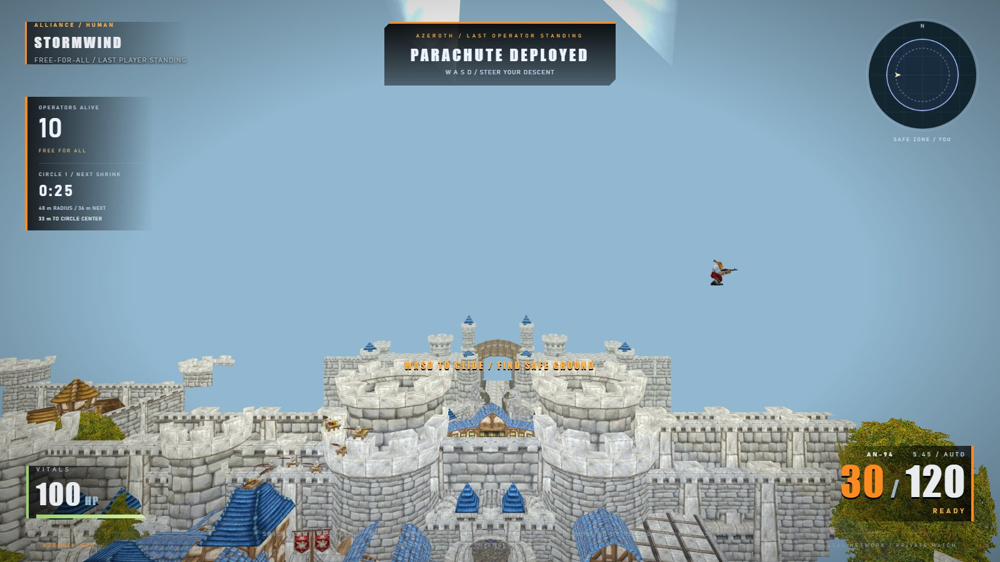

# Azeroth Ops

> **A parody / gag project.** Call of Duty-style combat in Azeroth. Unofficial, non-commercial, and not affiliated with or endorsed by Blizzard Entertainment or Activision.

## Disclaimer and assets

This repository contains **only original source code** (MIT, see `LICENSE`). It contains **no** World of Warcraft or Call of Duty game assets: `public/assets/`, `public/ui/`, `tools/` and `cache/` are git-ignored and must stay out of the repository. To run the game you need your own legally obtained copies of World of Warcraft: Wrath of the Lich King 3.3.5 (build 12340) and Call of Duty: Black Ops II, and you generate the assets locally with the import scripts (`npm run import:wow-all -- "<WoW folder>"`, then the BO2 `.ps1` imports listed under Development). Do not upload extracted assets. "World of Warcraft" and "Call of Duty" are trademarks of their respective owners.

## Screenshots

Captured from the running game with `node scripts/capture-screenshots.cjs` (headless, isolated server). The art is from the author's own local game installs and is shown for illustration only.

| | |
|---|---|
|  |  |
|  |  |
|  |  |

A custom local FPS engine and playable prototype built in this directory. It uses the real main city WMO geometry and textures from your Wrath 3.3.5 (12340) copy, plus the original AN-94, SCAR-H, DSR 50 and Ballista weapon models and color textures from your Black Ops II installation. Both game installations are read-only inputs.

## Play

Double-click **Start Azeroth Ops.cmd**, or open **http://127.0.0.1:8097** if the server is already running. Choose Stormwind, Dalaran, or Darnassus, choose Battle Royale, Undead survival, Horde vs Alliance, or Explore, and click Deploy. The game captures the mouse; Escape releases it and pauses. Chrome or Edge on a desktop with WebGL2 is recommended.

| Input | Action |
|---|---|
| WASD / mouse | Move / look |
| Left mouse | Fire |
| Right mouse | Aim |
| Shift | Sprint |
| Space | Jump |
| C | Toggle crouch / stand (Space stands and jumps when clear) |
| R | Reload |
| Q | Quick knife (also automatic when firing with no ammo or reserve) |
| Hold E | Repair barricades, clear roadblocks, buy wall weapons/ammo (Undead) |
| 1 / 2 | AN-94 / SCAR-H |
| 6 / 7 | DSR 50 / Ballista |
| 3 / 4 / 5 | Activate earned UAV / resupply / sentry |
| V | Toggle first/third person |
| F | Return to deployment point (practice/exploration only) |
| Escape | Pause and open city/mode selection |

Undead survival fortifies each city into three playable areas. Start with an AN-94 and 500 salvage points. Zombies and ghouls break six-board entry barricades and push through; hold E while looking at a nearby entrance to rebuild it. Damaging hits pay 10, kills add 100 (150 for a headshot), and repairs pay 10 per plank up to 60 per entrance per wave. Cart-and-crate roadblocks cost 750 and 1,500 points to open sequentially. Each expansion clears the previous interior barricades and moves the three active entrances to the new outer perimeter. Old entrances stop spawning. Weapon racks sell SCAR-H (1,000), DSR 50 (1,500) and Ballista (1,750); buying an owned gun refills it for 40% of the price (4,500 for a packed weapon). You carry two guns, or three with Mule Kick; a new wall purchase replaces the held weapon when full. Unpurchased weapon hotkeys are locked. Waves pause for eight seconds without free ammunition, then escalate enemy count, health, speed and melee damage. From wave three, ghouls run. The HUD shows points, breached entrances and nearby E interactions. The survival economy also runs in LAN Undead Co-op with shared defenses and individual wallets; LAN also offers team deathmatch and battle royale. Horde vs Alliance is a local 5-versus-5 bot match, first faction to 20 eliminations, with respawns and friendly fire disabled. Choose your faction and race; your four teammates use its remaining races. The opposing team includes all five races.

- Alliance: Human, Dwarf, Night Elf, Gnome, Draenei.
- Horde: Orc, Forsaken, Tauren, Troll, Blood Elf.

BO2-inspired killstreaks unlock from consecutive player weapon eliminations: 3 kills earns a 30-second UAV revealing enemies on the local radar through cover; 5 earns instant ammunition and health resupply; 7 earns a deployable sentry for 25 seconds with a 40-unit range. Sentry kills help the team score but do not extend your personal streak. Death clears progress, unused rewards, active UAV and sentry. Earning the seventh kill completes a reward cycle and starts progress toward the next 3/5/7 cycle; earned charges remain available until used or death. Restarting clears everything. These are prototype reward implementations, not extracted BO2 scorestreak logic.

Radar contacts appear only after gunfire or while your UAV is active. A shot leaves a fading two-second blip at its firing location; subsequent movement stays hidden until another shot. This applies to every other operator, including teammates. Silent undead stay off the radar unless revealed by a UAV. Gunfire and UAV reveals work through cover within radar range. LAN gunfire pings come from server-confirmed shots; knives and sentries do not reveal their owner's location. Your own direction arrow remains visible.

The Horde's playable Forsaken are separate from the hostile Scourge zombies and ghouls. Press V to see your chosen character in third person. Outside Battle Royale, health regenerates after six seconds without damage (5.5 for Trolls); racial passives can modify its rate. Combat stays within 75 units of deployment; Explore allows a much larger area. Falls into missing geometry return you to safe ground. Escape pauses and opens the restart/settings menu.

Double-click **Stop Azeroth Ops.cmd** to stop the server started by the launcher. The server listens on all local interfaces on TCP 8097 for LAN play; no router forwarding or online hosting is configured. Set `HOST=127.0.0.1` when launching Node to restrict it to this PC.

## Stable movement and crouching (build 0.13.0)

Walkable slopes no longer push an idle capsule downhill. Releasing WASD stops horizontal movement immediately; inactive controls cannot keep an operator walking.

Press **C** to crouch or stand. Crouching lowers the camera and collision height from 2.45 to 1.6 units, halves walking/aimed movement speed, and prevents sprinting. Space requests standing before jumping. Low ceilings keep you crouched until there is room to stand. Your feet stay in place during stance changes, and third-person characters bend their knees and lower their bodies. LAN clients synchronize crouch, and the server uses the lower firing position, collision shape, movement limit and player hit volume. Crouching also lowers solo enemy aim and interaction sightlines.

Verification uses small CPU fixtures for idle slopes, released input, crouch movement and camera height, low ceilings, and server stance/combat synchronization. No browser/GPU gameplay test was run for this update.

## Shared deployment, match menu and Horde zeppelin (build 0.12.0)

LAN matches now show each operator's map-loading progress. The server waits for every client to load the agreed map/layout and present its first frame, prepares their starting positions, and then runs a shared three-second countdown. Keep the game tab open while loading. Players enter the map automatically; if the browser requires a click to capture the mouse, click **Resume control**. There is no separate Enter Match step.

Alt-tab and Escape release the mouse and show a compact match panel over the game. Your connection stays active and the shared match continues. Return and click **Resume control** to recapture the mouse. The panel has the squad roster, saved-class selection for the next respawn, leader controls and results. The lobby leader can transfer leadership to another player; if the leader disconnects, the oldest remaining connected member takes over. This changes lobby control, not the PC running the Node server, which must remain online.

Moving jumps now follow mild ground slopes correctly, with a short jump buffer and ledge grace period. Air movement remains available, while tall cover and walls retain collision. Battle Royale uses the original Wrath Horde transport zeppelin hull, textures, balloon and authored doodad animations. Its deck sits below the airborne player position. Transport files are included in shared browser downloads; the original WoW secondary shader effects are not reproduced.

Validation uses sequential CPU fixtures for movement on ramps, moving jumps, server movement checks, loading generations, shared countdown/spawns, leadership transfer, focus/menu state, and the named zeppelin's geometry/animation/resource handling. No browser/GPU gameplay test was run for this update; real multiplayer timing and visual presentation still need an in-game check. Vanguard remains untouched.

## Knife, COD machines and Map Workshop (build 0.11.0)

Press **Q** for a quick knife in solo or LAN matches. Holding fire with an empty magazine and no reserve also uses it. The original BO2 knife model uses a local swing animation. A stab reaches two metres, deals 130 damage to undead or 100 to players, and recovers in 0.8 seconds. It needs line of sight, cannot interrupt a reload, and cannot be used while downed or reviving. LAN damage and recovery are server-authoritative. Q still changes spectators after elimination in Battle Royale.

The twelve functional perk stations and Pack-a-Punch now use actual BO2 machine meshes and color textures, with their existing purchase rules. Assets came from named-model exports of the installed Zombies zones; source paths are recorded in `public/assets/machines/provenance.json`. Machine animation and COD's original shader effects are not reproduced. A simple collision cabinet keeps their bullet and movement checks inexpensive and consistent across clients. The shared browser download pack includes the machines and knife.

Open **Map Workshop** from the main menu or multiplayer lobby, or visit **http://127.0.0.1:8097/editor.html**. It is a lightweight top-down editor:

1. Choose a city and search its imported WoW props, COD machine scenery, or the crate/cart/barricade library. Click **Place Asset**, then click the map.
2. Drag your placement or enter its X, Y, Z, rotation and scale in the inspector. Toggle solid cover to control walking and bullet collision. Click an original prop to hide or restore it.
3. Choose **Light** lower crate barriers, **Classic** tall walls, or **Open layout**. Open layout starts with every zone unlocked and retains three covered undead entries; the other presets preserve paid zone unlocks. Stormwind defaults to **Spooky night** for Zombies, with cold color grading and distance fog. Other deployed modes retain daylight.
4. **Save to Host**, then **Open Game** and start a fresh match. Existing LAN matches keep the layout they started with. Refresh an already open solo game to load edits. Layouts save under `public/assets/layouts/`; original imported assets are preserved.

Undo/redo, JSON import/export and browser draft recovery are included. The editor shows actual prop positions, not city terrain/building geometry; set Y manually and check placement in game. Added COD machines are scenery; the automatic perk stations provide purchases. Host-saved layouts apply to everybody joining a new LAN match, with the same placed and hidden collision geometry on the server.

Verification uses small sequential CPU fixtures for melee authority, editor saves/schema, placed collision, atmosphere, fortification styles, model fitting and resource cleanup. No browser/GPU gameplay test was run for this update; visual scale, placement and lighting still need an in-game check. Vanguard remains untouched.

## Map downloads and browser caching (build 0.10.0)

Open **Map Downloads** beside Deployment Zone in the main menu, or from the multiplayer lobby. Download Stormwind, Dalaran or Darnassus before your squad starts. Each city includes its geometry, props and textures, plus shared operators, guns, scopes, muzzle effects and gun audio. Shared files are stored once. The panel shows saved bytes and file counts, with cancel/resume controls; canceling keeps completed files. Keep the tab open to finish a download. Closing the panel lets it continue.

Normal asset loading saves files automatically, so revisiting a city or reloading the page reuses its saved files. The host publishes a revision catalog; changed files download again while unchanged files stay cached. **Check for updates** refreshes the catalog without downloading every asset again. The host caches its catalog for up to 30 seconds. Missing host imports are shown as unavailable. Removing a city preserves files shared with other cities; **Remove all downloads** removes the game asset copies, without changing saved classes.

Downloads belong to this browser and this server address (including its port). Friends should keep using the same LAN address. IndexedDB Blob storage works with the existing plain HTTP LAN server; no service worker, HTTPS setup, or installed game is required on their PC. Browser storage is subject to available quota and possible eviction: if it cannot save a file, the game can still read it from the host and the panel explains the problem. Clearing site data or using a different browser/address means downloading again. See [MDN's browser storage guidance](https://developer.mozilla.org/en-US/docs/Web/API/Storage_API/Storage_quotas_and_eviction_criteria).

This avoids repeated asset transfers; geometry parsing, collision construction, image decoding and GPU setup still happen when a city opens. This is **not an offline game installation**: opening the app and joining matches still require the host. Asset transfers and the city/character texture decode queue are limited to two at a time; weapon models parse one at a time. Map downloads never parse city geometry or render it.

Verification for this build uses tiny sequential catalog/HTTP fixtures, an injected cache store and IndexedDB transaction fixtures, mocked texture/GLB loaders, and a menu state fixture. Run `node --test --test-concurrency=1 tests/asset-catalog.test.cjs tests/asset-cache.test.cjs tests/asset-loaders.test.cjs tests/downloads.test.cjs`. No full asset scan, game launch, browser/GPU test, or Vanguard change was performed for this build. Real browser persistence and loading times still need an in-game check when graphics testing is appropriate.

## LAN multiplayer (build 0.7)

1. Start this PC's server with **Start Azeroth Ops.cmd**. Open **MULTIPLAYER**.
2. Use **Operator** to choose your callsign (and optional clan tag), faction and race. Use **Create a Class** to select one of five saved classes and inspect its weapons. Return to **Play** and create a lobby. The panel displays this PC's address and a six-character room code.
3. Friends on the same home network open that address in Chrome or Edge, then join the lobby by code or lobby list. Use **Your Operator** directly above the team rosters to change faction and race. The race list and passive follow your faction, and changing either clears your Ready status. Full TDM factions are marked **FULL**; factions and races lock once loading starts. The same controls remain available on the Operator tab. Friends receive game assets from this server; the first load can take longer. **Map Downloads** can save cities ahead of time, and saved assets are reused on later visits.
4. The host chooses a city and mode. For Team Deathmatch, choose opposing teams (up to five per faction), a score limit and a time limit. Battle Royale needs 2-10 players; faction is cosmetic and everyone is an opponent. The host can add AI bots to any slot (see *Bots in LAN rooms*). Everyone clicks **Ready up**, then the host starts the match.
5. Keep the tab open while everyone loads. The shared countdown deploys everyone automatically. Click **Resume control** if the browser needs a gesture to capture the mouse. **1 / 2** switch your two class weapons; **Tab** displays the scoreboard. **Escape** opens the compact match panel without pausing the shared match; select a saved class there for your next respawn.

Five named classes are saved in browser storage. Each carries a primary and secondary from the four imported weapons, plus Balanced, Fast Hands (15% quicker reload), Stockpile (50% more reserve ammunition), or Lightweight (8% movement boost). The class editor compares actual damage, ammunition, aim time, reload time and firing cadence, including perk effects. Mid-match class changes apply at the next respawn. Classes persist across reloads on the same server address/browser; no account is required.

Team deathmatch uses a shared 20 Hz WebSocket server. The server owns weapon/ammunition timing, damage, team score, match timer, streak rewards, deaths and respawns. It checks movement distance and collision; bullets test the actual imported city/prop cover. Player hit volumes are standing boxes sized by race, rather than animated per-triangle server meshes. Movement is client-predicted and server-validated; this LAN prototype has no rewind lag compensation or competitive anti-cheat.

Initial spawns and respawns randomly sample clear ground connected to the city navigation graph. Candidates need head/body clearance, at least 14 units from live enemies and three units from other players; the least-exposed visibility tier is selected first, then a random point is chosen with mild teammate proximity weighting. Cover rays use the actual enemy firing height and require both torso and head protection. Respawns avoid the previous location, wait if no safe location exists, and grant two seconds of protection (firing ends it). Death has a three-second respawn delay. Streaks and active rewards clear on death. UAV, resupply and sentry rewards run on the server. Friendly fire is off.

The host can return everyone to the lobby after results. Host control transfers when a player leaves; empty rooms are removed. Socket loss returns the affected player to the menu. Solo practice, exploration and undead waves remain available separately.

Validation: `npm test` covers server lifecycle, host permissions, class validation/perks, weapon restrictions, damage, respawns and existing engine behavior. `node scripts/check-lan.cjs` runs two isolated browser clients through persistent classes, ready/start, replicated movement, a real WebSocket PvP elimination, respawn/class changes, scoreboard, results and returning to practice. It uses DOM-only pointer-lock simulation and an isolated temporary server. Physical access from another home PC still depends on that PC's network path and Windows firewall.

## LAN Undead Co-op and racial passives (build 0.9.0)

Choose **LAN Multiplayer ? Create Lobby ? Undead Co-op**, choose a city, and ready up. One to four survivors can start; Horde and Alliance cooperate with friendly fire disabled. Every survivor begins with an AN-94 and 500 points. Saved PvP classes do not apply. Waves, boards and unlocked areas belong to the room; points, weapons, perks and Pack-a-Punch belong to each player. The server owns enemy spawning, navigation, cover checks, damage and purchases. Enemy counts scale with squad size without adding health per extra player. Escape opens the match panel while the match continues.

Lethal damage puts a survivor down for **30 seconds** (36 for Forsaken). Their body remains where they fell; downed players cannot move, shoot or buy. A living teammate can **hold E within 2.5 metres with clear line of sight for four seconds**. Releasing E, changing targets, losing proximity/line of sight, disconnecting or taking damage interrupts the rescue. Only one helper contributes, and reviving locks weapon actions. A revive restores 40% of current maximum health and grants two seconds of protection. Downing removes perks and any Mule Kick third weapon. Bleeding out means waiting for the squad to clear the wave; the survivor then returns with starter equipment and at least 500 points. A squad with nobody able to recover loses the match.

Co-op recovery differences:

- **Quick Revive:** 1,500 points; teammate revives take two seconds. It does not self-revive in LAN, including a one-person LAN room, and has no three-purchase limit. Human duration is 1.7 seconds with this perk, 3.4 without it.
- **Who's Who:** consumed on a down. Release E, then hold E for eight seconds within a 15-second window to rescue yourself at your fixed body. Human duration is 6.8 seconds. The match waits for this possible rescue before declaring a squad wipe. This is a co-op adaptation; solo retains its moving ghost.
- **Tombstone:** drops an owner-only equipment stash at the body. Recover it after an ally rescue or next-wave return by holding E nearby for one second. The 45-second expiry begins when you return alive. Recovery consumes Tombstone and cannot duplicate its equipment.

All twelve machines and Pack-a-Punch remain in co-op. Cherry shocks and PhD landing blasts use server line of sight. Vulture drops belong to the killer and appear on the accessible side of an entry when the enemy died behind boards. Mist, enemy markers and equipment markers are synchronized to the relevant perk owner. Killstreak rewards remain outside co-op.

Each player race has one modest passive, displayed in the race picker:

| Race | Passive |
|---|---|
| Human | Revival actions take 15% less time. Conditional support choice. |
| Dwarf | 8% less recoil kick. |
| Night Elf | 3% faster movement. |
| Gnome | Reload and empty reload take 5% less time. |
| Draenei | Natural regeneration heals 15% faster after its delay. |
| Orc | Aim-down-sights transition takes 6% less time. |
| Forsaken | Co-op bleedout lasts 36 seconds instead of 30. Conditional support choice. |
| Tauren | 5 extra maximum HP: 105 normally, 255 with Juggernog. |
| Troll | Natural regeneration starts after 5.5 seconds instead of 6. |
| Blood Elf | 10% more reserve ammunition, rounded down. |

Racials do not increase bullet damage, fire rate or magazine size. They compose once with existing upgrades. Standard rifle body-shot counts and sniper torso one-shots remain unchanged by Tauren's bonus, though mixed hits and certain zombie damage levels can require another hit. Race model geometry is unchanged. This is an analytical first balance pass, not a claim of equal competitive win rates. Regeneration racials do not add regeneration to Battle Royale, and support racials need their corresponding recovery mechanic. These bonuses currently apply to players; practice bots retain their existing stats.

Verification for this update: **59 lightweight tests passed in sequence**, covering server/WebSocket co-op fixtures, revive interruption and squad wipes, shared purchases, cover, perk recovery, racial thresholds, lobby/client message behavior and existing solo/BR rules. Fourteen edited JavaScript files passed syntax checks. Following the reported PC crash, no graphical browser tests, full city asset tests, game launches or production restarts were run for 0.9.0. The changes are in the source; in-game visual/performance verification remains outstanding. Vanguard and Riot processes/services were not modified.

## Connected defenses and enclosed entries (build 0.8.1)

Survival starts in a larger walking area. Buying a roadblock clears **all** obsolete boundary panels for that expansion, so the next area's machines, weapon racks and entrances stay connected to the starting streets. Timber remains on the current outer boundary, with low visible rails at uncovered city edges. Movement slides along walls and cabinets; overlapping an obstacle no longer traps the player. The old invisible nearest-navigation-cell movement restriction is removed.

Three enclosed breach alcoves operate on the current perimeter. Each has side walls, a back, a roof and an internal baffle that hides the spawn point. Undead walk around the baffle, attack the six boards and cross a floor-level opening after the boards break. Their whole approach/release route checks collision. When an area opens, old alcoves are removed and retired from spawning; undead already entering finish walking into the expanded area.

Validation includes a real-city navigation search at every unlock stage, requiring every unlocked machine/rack and active entrance to be reachable. `node scripts/check-entry-routes.cjs` observes normal queued entry movement and then uses actual W-key walking and E-key purchases to traverse both expansions in each city, without teleporting the player. `tests/fortification-motion.test.cjs` covers sliding, swept collision, overlap escape and low obstacle collision. Original props in all three cities now participate in the same movement and bullet-cover checks used by LAN play.

## Pack-a-Punch and Zombies perks (build 0.8)

Undead survival now places twelve perk machines and one Pack-a-Punch machine in **each city**. Open the cart roadblocks to reach the later machines. Look at a nearby machine and hold **E** to buy. Four perks can be active at once; the HUD shows the ones you own. Machines are original prototype models with colored signage and solid cover. The [BO2 perk roster](https://steamcommunity.com/sharedfiles/filedetails/?id=135266390) guides this set; effects below describe our implementation, including solo adaptations.

**Pack-a-Punch costs 5,000 points** in Area 3. It upgrades the current weapon once: double damage, 50% larger magazine (rounded up), double reserve, full ammunition and a violet weapon finish. Double Tap stacks with its damage bonus. Returning to an owned upgraded wall weapon costs 4,500 to refill ammo. Upgrades and purchases reset with a new match.

| Perk | Points / area | Implemented effect |
|---|---|---|
| Juggernog | 2,500 / 1 | 250 maximum health; purchase fills health. |
| Quick Revive | 500 / 1 | Four-second solo self-revive; all perks are lost. Maximum three purchases per match. |
| Stamin-Up | 2,000 / 1 | 25% faster movement. |
| Deadshot Daiquiri | 1,500 / 1 | 35% less spread and recoil; mouse aiming stays manual. |
| Double Tap II | 2,000 / 2 | Double bullet damage and 33% faster firing. This uses one stronger hitscan rather than two separate projectiles. |
| Speed Cola | 3,000 / 2 | Reloads take half as long. |
| Mule Kick | 4,000 / 2 | Third weapon slot; losing the perk loses that third gun and its upgrade. |
| PhD Flopper | 2,000 / 2 | Landings after a drop of at least 1.2 metres produce a 150-damage blast within five metres. A full jump can trigger it. This is a landing adaptation; there is no prone dive or incoming explosive/fall damage yet. |
| Tombstone Soda | 2,000 / 3 | Solo adaptation: return after four seconds with an AN-94, then recover the dropped equipment stash within 45 seconds by holding E for one second. Tombstone is consumed. |
| Who's Who | 2,000 / 3 | Become an unarmed, untargetable ghost for 15 seconds. Move back to your marked body and hold E for two seconds to recover equipment and other perks. Who's Who is consumed. |
| Electric Cherry | 2,000 / 3 | Reloading shocks and stuns nearby undead for two seconds. An emptier magazine increases damage from 20 to 100 and radius from two to five metres. Each gun must fire again before another shock; cancelling a reload cannot repeat it. |
| Vulture Aid | 3,000 / 3 | Mark undead and unlocked equipment through walls. Kills drop one magazine of reserve ammo or 50 points; some leave ten-second mist that hides you while inside. |

Shock and landing blasts respect solid cover. Revival priority is Who's Who, then Quick Revive if ghost recovery fails, then Tombstone if available. Successful revives grant two seconds of damage protection. Holding E through recovery cannot accidentally purchase a nearby machine. The descriptions in this table are the **solo Undead survival** rules. LAN Undead Co-op uses the same weapon and combat perks with the recovery changes documented below. LAN TDM and Battle Royale retain their own rules. Human recovery actions take 15% less time than the base durations shown here.

`node scripts/check-perks.cjs` verifies real purchases, enhanced weapon hits/reloads, jump-triggered PhD, pickups, ghost movement, all three recovery paths and reset. `node scripts/check-perk-machines.cjs` verifies all thirteen placements, interactions and cover in all three cities and captures screenshots. Controlled test fixtures fund purchases, position actors and freeze threats; normal play provides no upgrade cheats.

## LAN Domination

Choose **Domination** in a LAN lobby for 5-versus-5 objective play (two teams, up to five per faction, same rules for class, respawns and killstreaks as Team Deathmatch). Each city gets three capture points, **A**, **B** and **C**, chosen deterministically by the server from the arena's connected safe ground (`src/domination-rules.mjs`): they lie along the longest axis of the spawn set (A and C near the ends, B in the middle), on flat footing with open ground around them and at least 15 m apart.

- **Capturing:** a point is captured by standing within 6 m of it with no enemy inside. One player takes about 5 seconds from neutral to owned; two take 2.5 s and three or more take about 1.7 s (3x cap). If both teams are inside, the point is contested and frozen. An owned point must first be neutralised by an enemy before they can capture it, and an empty point keeps its owner.
- **Scoring:** every 5 seconds each owned point gives its team 1 point. **Eliminations do not score** (they still count on the scoreboard). The first team to the score limit (100, 200 default, or 300) wins; at the time limit the higher score wins, and equal scores are a draw.
- **Spawns:** the existing safety rules (cover tiers, distance from enemies, occupied points) are unchanged; among equally safe spawns, points nearer the team's owned points are more likely and spawns on top of enemy-held points are less likely.
- **Authority:** the server decides presence, capture and score from its own positions and sends point state (owner, progress, contested, player counts) in the room snapshot. The client draws a world ring and pillar per point plus an A/B/C strip with score bars (`src/domination-view.js`, `renderDominationHud` in `src/match-ui.js`, `public/domination.css`).

Validation: `node --test --test-concurrency=1 tests/domination-rules.test.cjs tests/domination-server.test.cjs` covers placement, capture and contested rules, tick scoring, win conditions, spawn weighting, settings validation and the server-driven win/results flow using CPU-only fixtures. It has not been graphically play-tested.

## Azeroth Battle Royale

Choose **Battle Royale** in Solo for a ten-contestant match against nine bots, or select it in a LAN lobby for 2-10 human players. Everyone fights individually, including players of the same faction. The last survivor wins; eliminated players stay dead and can spectate with **Q / E**.

A zeppelin flies across the selected city for 18 seconds. Press **Space** or click the drop button to jump; remaining passengers drop automatically. **WASD** steers the glide, and landing settles you on nearby safe, connected street geometry. Weapons activate after landing. LAN players use their selected custom class; solo practice uses the existing four-weapon selection. There is no loot-scavenging system yet.

The safe circle closes in four stages, with increasingly damaging storm exposure. The HUD shows survivors, circle timing, radius, and a safe-zone minimap. There are no respawns, killstreaks or health regeneration in this mode. LAN flight, descent, landings, storm damage, eliminations and victory are controlled by the server. Escape pauses solo but does not pause a LAN match.

This first version uses a compact arena within Stormwind, Dalaran or Darnassus, not one continuous Azeroth world. The zeppelin and storm are original prototype visuals; the city and character assets are the existing imports. City roofs and missing terrain are not a free-form landing surface: deployment resolves onto the safe street navigation graph.

Validation: `node scripts/check-royale.cjs` exercises flight, manual/automatic drops, gliding, landing, combat, storm damage, elimination/spectating and reset across all three solo cities. `node scripts/check-royale-lan.cjs` checks two browser clients, same-faction combat, authoritative landings/damage, winner results, no respawns, minimap and return to a TDM lobby. Controlled fixtures accelerate later circle phases and position players for repeatable assertions; both scripts use DOM-only pointer-lock simulation.

## Weapon attachments

Each class weapon (primary and secondary) can carry one attachment, chosen in the Armory. Attachments apply to LAN Team Deathmatch, Domination and Battle Royale classes; the server re-validates every id against the equipped weapon and applies the result authoritatively. Solo practice and both Undead modes do not use classes and are unchanged. Lethal and Tactical remain locked placeholders.

| Attachment | Valid on | Effect |
|---|---|---|
| Extended Mags | AN-94, SCAR-H, Ballista | +50% magazine (rounded up); reloads 10% longer |
| Fast Mags | all four | reloads 15% shorter; magazine unchanged |
| Foregrip | AN-94, SCAR-H | 30% less recoil kick; ADS in 10% slower |
| Suppressor | all four | shots do not ping enemy radar (UAV still reveals you); damage fades linearly to 85% between 20 m and 40 m |
| Red Dot | AN-94, SCAR-H | ADS zoom FOV 50 to 46 degrees; ADS in 5% slower |

Order of composition is base weapon, attachment, class perk, racial passive. Modifiers are multiplicative, so Fast Mags with Fast Hands is 0.85 x 0.85. Definitions live in src/attachments.mjs on top of the generated src/weapon-data.js. Saved classes without attachments load with empty slots. Source and unit tests cover this; it has not been play-tested in game.

## Sessions, profiles and ranks (build 0.14.0)

This is a LAN gag project. There are no accounts and no passwords. Your browser generates a random session token (`localStorage` key `ao-session-v1`) and sends it in a WebSocket `hello`. Anyone holding the token is you. Treat it like a bearer cookie; do not expose the server to the internet. The server only keeps a salted SHA-256 of the token, never the raw value, and never logs it. A second window using the same token is refused with a clear error rather than replacing the first.

- Reconnect: if your socket drops during loading, countdown, play or the results screen, your seat (room, team, position, weapon, score) is held for 60 seconds. Reconnecting with the same token resumes it; the lobby retries automatically. After 60 seconds, or if the room returns to the lobby, you are removed as before. Disconnecting in a lobby removes you immediately, as before. A held player stays in the world (and can be shot) while away.
- Profiles: `data/profiles.json` (git-ignored; override with `AO_PROFILES`). Written atomically (temp file plus rename), debounced, capped at 2000 profiles / 4 MB, versioned. A corrupt or oversized file is renamed to `profiles.json.corrupt-<time>` and a fresh store starts. Logic: `server/profiles.mjs`.
- Progression rules (`src/progression.mjs`, shared): level curve for levels 1 to 30, 30 rank names (Peon up to Warchief), the XP table, per-match caps and the unlock catalog. The server is authoritative: clients cannot submit XP.
- XP: kill 100, headshot +50, knife +25, point capture 150, Domination point control 10 per 5 s, undead kill 50 (100 headshot), wave survived 200, revive 150, match complete 300, win +500. Repeat kills of the same player pay 100%, 100%, 50%, 25%, then 0; undead kills past 60 per match pay half; per-category and 6000 XP per-match caps apply (completion and win bonuses are exempt). Level N to N+1 costs `400 + 100 * (N - 1)` XP.
- Unlocks: AN-94, SCAR-H and Fast Mags are free. Extended Mags 4, Foregrip 6, Red Dot 8, Suppressor 10, DSR 50 at 12, Ballista at 16; class slots 4 and 5 at levels 8 and 14; perks, titles, emblems and camo tints in between. Guns not yet in the catalog stay free; add them to `UNLOCKS` or `FUTURE_WEAPON_LEVELS`. The server swaps locked weapon, attachment and perk picks for free ones and tells the player; clients without a session token are unrestricted.
- UI: a level badge and XP bar in the lobby header, an XP breakdown in the end-of-match panel, and `[LVL n]` tags on locked Armory options (layout unchanged).

## Bots in LAN rooms

Team Deathmatch, Domination and Battle Royale lobbies can hold **AI operators** that occupy normal player slots. Undead Co-op is out of scope (it already runs the server-side undead AI) and has no bots; switching a lobby to Undead Co-op removes its bots.

- **Host controls** (the **AI OPERATORS** panel in the lobby, leader only, lobby phase only): add a bot to Alliance or Horde, **KICK BOT** on any bot row, a per-room **difficulty** (Easy / Normal / Hard, applied to every bot in the room), **Fill empty slots** with an **occupant target** (2-10). Fill keeps the lobby at the target by adding or trimming bots as humans join and leave (humans are never removed; a joining human takes a bot's seat in a full lobby or faction). Manual add/kick while fill is on moves the target.
- **Limits:** five per faction in Team Deathmatch and Domination, ten occupants in total (also the Battle Royale cap). Bots count toward faction caps and the Battle Royale 2-10 minimum, so **one human plus bots can start** any supported mode. Bots are auto-ready, auto-loaded and never block the start. They are shown in rosters, the match panel and the scoreboard as `[BOT] Name` with faction and race, and their callsigns come from a fixed Azeroth-flavoured pool (`src/bot-rules.mjs`), unique per room; humans cannot claim those names.
- **After a match:** with fill **off**, bots persist in the lobby as ordinary members (ready for the next start). With fill **on**, they are discarded and regenerated at the target. When the last human leaves, the room and its bots are removed. Bots hold no reconnect session and never have a profile.
- **XP:** bots never earn XP or profiles. A kill on a bot pays **25%** of the normal kill XP, and the XP earned from bot kills is limited by a **weekly allowance of 3000 XP per profile** (`WEEKLY_BOT_XP_CAP`, a Monday-to-Monday UTC week stored on the profile; anti-farm); the rest is dropped when the match is credited. Bot kills do not add to the profile's kill statistic. Bots do **not** earn killstreak rewards (UAV, resupply, sentry stay off for bots). Kills by and on bots count for the team score, the scoreboard and Domination XP rules as usual.
- **Same rules as humans.** A bot is an ordinary room member driven by messages it sends itself (`pose`, `fire`, `reload`, `switch`, `melee`, `jump`); the authoritative server validates them exactly like a browser's: movement speed and collision (`createArenaStance` / `CharacterCollision`), shot-blocking cover, `WeaponSimulation` timings for all twelve guns (including semi, burst, pump and bolt), ammunition and reloads, damage curves and hit regions, spawn choice (`chooseTeamSpawn`) and respawn protection. Bots fire real `shot` events, so tracers, audio and radar pings behave exactly like a human's.
- **Perception, no wall hacks.** Enemies are known only through line of sight (the bullet-blocking mesh) inside a forward vision cone and a range limit, plus a short memory of where they were last seen and team **callouts** of those sightings (with a radio delay). Taking damage turns a bot toward the source after a reaction delay. Spawn-protected enemies are ignored.
- **Behaviour:** pathfinding on the arena's ground graph with straight-line smoothing, strafing, optional crouch-fighting at range, retreat to cover when hurt or reloading under fire, reloading when safe, sidearm swap when empty and the knife as a last resort, burst control, no shots through teammates, stuck detection with sidestep, detour and re-route. **Domination:** bots pick the nearest uncaptured or contested point, spread out (at most about two per point), defend owned points when enemies are near, and stay inside the capture radius while fighting. **Battle Royale:** bots board the zeppelin, jump at a random moment, glide to a chosen safe node (half aim for the middle of the map), then move with the shrinking circle and fight.
- **Difficulty parameters** (`DIFFICULTY` in `server/bots.mjs`):

| | Easy | Normal | Hard |
|---|---|---|---|
| Decision rate | 5 Hz | about 6.7 Hz | 10 Hz |
| Reaction delay | 600-900 ms | 320-520 ms | 160-260 ms |
| Vision range / cone half-angle | 50 m / 55 deg | 70 m / 65 deg | 95 m / 75 deg |
| Aim error (per axis, at 0 m; grows with distance and own movement) | 1.6 deg | 0.8 deg | 0.38 deg |
| Aim turn rate | 140 deg/s | 260 deg/s | 520 deg/s |
| Recoil compensated | 20% | 55% | 80% |
| Burst length / pause | 2-4 rounds / 0.65-1.2 s | 3-6 / 0.3-0.65 s | 4-9 / 0.12-0.35 s |
| Memory of lost targets | 3 s | 5 s | 8 s |
| Weapon classes | no snipers or LMG | all | all |

- **CPU budget:** bots think at 5-10 Hz in staggered slots; movement, aim and fire run on the existing 20 Hz tick. The synthetic-arena measurements are about 0.1-1 ms per 50 ms tick for ten occupants with nine bots (`tests/bots.test.cjs`, `tests/bots-server.test.cjs` print the numbers); real city meshes cost more per ray, so expect a few ms at worst.
- **Server messages (host only):** `bot-add {team?}`, `bot-remove {id}`, `bot-settings {difficulty?, fill?, target?}`; the room snapshot carries `bots: {difficulty, fill, target, supported, count}` and each player has `bot: true|false` and `tag`.

Validation: `node --test --test-concurrency=1 tests/bots.test.cjs tests/bots-server.test.cjs` covers perception gating, reaction delay, aim-error distribution, pathing, stuck recovery, Domination goal choice, all twelve guns, lobby validation (non-host, bad faction, caps, difficulty), fill, Battle Royale deployment, scoring, reduced XP, profiles and cleanup using CPU-only fixtures. **No in-game validation of bot feel has been done**; it has not been graphically play-tested.

## Custom callsigns and clan tags

The **Operator** tab has a **Callsign** and an optional **Clan tag**. They are shown everywhere as `[TAG] Name` (lobby, match panel, scoreboard, kill feed and in-game nameplates share one formatter, `formatName` in `src/names.mjs`). Bots always read `[BOT] Name`. Names are never coloured by the player and are always rendered with `textContent` or canvas text, never as HTML.

- **Callsign rules:** 3-16 characters from ASCII letters, digits, space and `_ - . '`; it must start and end with a letter or digit; surrounding spaces are trimmed and repeated spaces collapse. Control characters, zero-width and bidirectional marks, emoji and every other non-ASCII character are rejected (never silently stripped). `BOT`, `Admin`, `Server`, `System` (including spaced or numbered variants such as `Bot 7`) and every bot-pool name are reserved.
- **Clan tag:** 2-4 ASCII letters or digits, shown upper case; `BOT`, `ADM`, `SYS`, `SRV`, `MOD` and `GM` are reserved. Leave it empty for no tag.
- **Profanity:** a small local list with leetspeak and repeated-letter normalisation (`src/names.mjs`, stored base64-encoded so the source stays tame). A filtered callsign is replaced by `Operator NNN` and the player is told; a filtered tag is refused.
- **Uniqueness:** case-insensitive within a room. A colliding name receives an automatic suffix (`Name (2)`, `Name (3)`, always within 16 characters); players cannot type the suffix themselves. Leaving a room restores your plain callsign.
- **When you can change it:** in the lobby and at the results screen, not while a match is loading, counting down or running. The server allows **one change per 10 seconds** (your first change after connecting is free). Rejected changes keep your previous callsign and explain why. The server is authoritative; the client checks only for live feedback in the Operator tab.
- **Persistence:** the accepted callsign and tag are saved to your profile (`callsign`, `tag`) and echoed in `profile`, `callsign` and `room` messages; the browser also remembers them (`ao-player-name`, `ao-player-tag`). Profiles loaded from disk are re-validated.

Validation: `node --test --test-concurrency=1 tests/names.test.cjs tests/names-server.test.cjs` covers the validation matrix, hostile Unicode, reserved names, profanity, uniqueness, the formatter, rename rules and persistence, plus a source scan proving no `innerHTML`-style sink receives a name.

## Lobby interface

Build 0.5 replaces the menu shell with full-screen Play, Create a Class and Operator views. Play pairs a captured city backdrop with the lobby browser or faction rosters; five selectable class cards lead to a live 3D weapon preview and actual weapon statistics. Operator pairs callsign/faction/race selection with the animated character. The home screen separates multiplayer from solo deployment, with city cards and an operator preview. Layouts adapt to smaller windows; class details scroll on short screens. Keyboard focus is visible and reduced-motion preferences stop the armory turntable.

`node scripts/check-ui.cjs` checks navigation, persistent class-card focus, layout overflow and basic control contrast at three window sizes, saving screenshots to `artifacts/`. `node scripts/capture-menu-art.cjs` regenerates the city backdrops from the local game renderer.

## Game design direction

The first multiplayer slice is a complete private-match loop: choose an Azeroth arena and faction, build a class, ready both teams, deploy, finish team deathmatch, review the scoreboard, and return to the same lobby for a rematch. Clear aiming, physical cover and reliable hit feedback take priority over additional weapon inventory. Random spawning prioritizes survival and spacing before variety. All existing rewards and classes must affect actual gameplay rather than only menu labels.

The agent design pass divided work between combat/spawn design, lobby/class UX and match lifecycle rules. The integrated result adds safer random deployments, weapon comparison cards, clearer readiness/loading states, stable roster rendering, player-name labels and visible spawn protection. Loading cancellation, disconnected hosts, stale map loads and results are covered by regression tests.

Planned design milestones, not implemented features: authored (hand-placed) objective areas and Hardpoint (LAN Domination currently uses computed points); and a decision on race combat silhouettes before competitive balancing. Current server hit volumes vary with race height and camera height is standardized. The new modest racials are a first balance pass; their competitive value still needs playtesting. Future progression and public matchmaking must be implemented and tested before being presented as available.

## Scope of this build

- Actual textured city structures, streets and interiors: Stormwind Trade District, Dalaran central streets, Darnassus Temple Gardens deployment areas.
- Original BO2 rifle/sniper, scope and magazine meshes/color textures. ADS uses original model sight tags and patch transition times; sniper overlays are original BO2 images. Movement, recoil and reload motion remain custom implementations. Gun audio now uses original BO2 recordings with a custom Web Audio mixer and reconstructed Foley timing. No animated hands yet. Muzzle flashes use original BO2 gas-flash/flame texture atlases extracted from the installed game, with DDS-to-PNG conversion and recorded source hashes. The procedural starburst has been removed. Original AN-94/SCAR-H FX names are preserved in `public/assets/effects/provenance.json`. Native FX element graphs cannot currently be dumped by OpenAssetTools, so timing, sizing and layer playback remain local implementations; this is not an exact port of BO2 effects.
- Capsule-versus-triangle collision, gravity, jumping, step assistance, hitscan, wall occlusion, ammunition, health, HUD and radar. Eye height is 2.45 world units, shared by camera placement, collision and AI targeting.
- Stormwind includes all 6,157 prop placements from its default WMO doodad set: 311 original models including fountains, carts/wagons, lamps, signs, benches, crates and trees. Dalaran adds 4,631 placements across 808 models; Darnassus adds 1,073 across 175 models. Two Dalaran smoke-only placements have no renderable mesh and are omitted. Rendering uses instancing; original M2 collision hulls join both client and server city colliders. Props use static poses. All six Stormwind fountains now have reconstructed animated water surfaces, streams and spray fitted to their original placement; these are new effects rather than an emulation of the original particle system.
- Bullets and bot line of sight use a dedicated cover mesh containing city surfaces, prop collision hulls and opaque prop details. Player shots resolve from body height after aiming, so an offset third-person camera cannot shoot around cover. Solid cover stops rounds; no wall penetration. Water/spray remain non-solid.
- Solo AI practice, LAN team deathmatch, LAN Domination and free-for-all battle royale for up to 10 players (any slot can be filled by a server-side AI operator, see *Bots in LAN rooms*), plus LAN Undead Co-op for up to four (no bots). No internet matchmaking, account system or persistent XP progression.
- Original Wrath character meshes, textures, skeletons and animation tracks, including death and attack animations. Each playable race currently uses one curated male NPC appearance; full character creation and equipment are not implemented. Player collision/eye height are standardized across races.
- Ground navigation follows a bounded grid sampled from city collision geometry. Spawn candidates require flat footing, headroom, body clearance and connection to the ground graph. Initial enemies are spaced at least four units apart and start at least twenty units from the player. Survival starts on visible approach routes; faction starts favor cover. Respawns avoid live enemies within twelve units and prefer occluded locations, waiting if no safe location is available. Complex stairs, narrow corners and missing terrain can still limit bot movement. Rifle placement uses a prototype attachment pose.
- This imports the principal **WMO city models**, not the entire WoW world. ADT terrain, ADT-placed objects, NPC populations, water effects, original lighting and some special materials are not yet reconstructed. Default-set WMO props are included in all three cities. Streets and interiors are usable, but exploration can reveal gaps and visual differences. Darnassus is especially incomplete outside its architectural areas.
- City imports preserve the original textures; current rendering uses their base color rather than fully reproducing WoW's material pipeline.

## Engine and weapon data

The engine owns fixed-step gameplay (120 Hz), capsule collision, input, hit resolution, weapon state, navigation, AI and game rules. Three.js supplies rendering and glTF loading; three-mesh-bvh supplies accelerated geometry queries. This is our FPS runtime, not the BO2 executable or a replacement graphics API.

Shooting now rejects off-ray and occluded characters with conservative animated bounds before running the original exact triangle hit test. Static fortifications use cached bounds while retaining real board gaps, repaired boards and opened gates. Firing updates actor transforms instead of forcing another whole-city transform pass. Two permanent muzzle lights retain a stable shader configuration, and world flashes/tracers reuse bounded pools. Tracer positioning and radar/HUD updates run once per rendered frame; physics still runs at 120 Hz. Muzzle alignment, body-origin cover checks, hit regions and damage rules are preserved.

Shooting-performance validation: `node --test --test-concurrency=1 tests/ballistics.test.cjs tests/skinned-raycast.test.cjs tests/cover-raycast.test.cjs tests/muzzle-effects.test.cjs tests/tracer-pool.test.cjs` passed all 17 CPU-only checks. Tests verify exact-hit equivalence across animated poses, zero skinned vertex evaluations for rejected targets, repaired/open cover, stable light count, pooled resources over 1,000 shots, and muzzle-aligned cover-clipped trails. No browser/GPU benchmark was run for this change; actual Stormwind frame rate remains to be checked by playing. Refresh the browser to load the updated client; downloaded assets remain cached.

Weapon simulation is independent of rendering. Original installed `common_patch_mp.ff` definitions override `common_mp.ff`; source fields and hashes are retained in `public/assets/weapons/definitions.json`. Generated `src/weapon-data.js` drives capacities, ADS transitions/zoom, reload and empty-reload times, fire intervals, bolt cycles, range damage curves and location multipliers. BO2 range units are converted with 0.0254 metres per unit. Reserve ammunition remains a local four-magazine allowance. Optic FOV is applied to the runtime camera; hit regions are approximated by height on WoW characters, not native BO2 collision hitboxes.

| Weapon | Magazine | Base damage | ADS in | Reload / empty | Shot cycle |
|---|---:|---:|---:|---:|---:|
| AN-94 | 30 | 40 / 33 / 24 by range | 0.25 s | 2.475 / 3.105 s | 0.064 s first interval, then 0.096 s |
| SCAR-H | 30 | 45 / 33 by range | 0.25 s | 2.4 / 2.95 s | 0.096 s |
| DSR 50 | 5 | 98, multiplied by hit region | 0.4 s | 3.4 / 4 s | 1.5 s |
| Ballista | 7 | 95, multiplied by hit region | 0.35 s | 3.1 / 3.75 s | 1.26 s |

Right mouse aims; sniper rifles require a fresh trigger press after bolt recovery. Weapon switching cannot bypass recovery. Reloading lowers the scope. Select a weapon in the pause menu or use its hotkey. No native BO2 animation playback, networking, engine binary or exact recoil solver is claimed.

## Original weapon audio

Build 0.7.1 replaces synthetic gunshots and reload tones with **15 original BO2 WAV recordings** for the AN-94, SCAR-H, DSR 50 and Ballista: firing, magazine handling and bolt/charging sounds. Local shots play immediately; LAN echoes do not play them twice. Other players and armed bots use the correct weapon recording with distance attenuation and stereo positioning. Audio unlocks when you deploy. Weapon switches, death and leaving gameplay cancel local reload/bolt sounds.

The importer follows the original `mpl_common.all` aliases; BO2 itself shares the primary player/NPC shot recordings and several reload Foley clips. The recordings are copied unchanged. Reload and bolt cue timing is reconstructed to fit our weapon simulation, including faster-reload perks; the native BO2 animation notetracks, secondary bass/decay layers and sound mixer are not reproduced. Hit confirmation and survival barricade sounds remain synthesized.

Rebuild with `powershell.exe -NoProfile -ExecutionPolicy Bypass -File scripts/import-audio.ps1`. It preloads `code_post_gfx_mp.ff` before exporting `common_mp.ff` sound banks using the existing OpenAssetTools installation. Output WAVs and source-bank/alias/file hashes live in `public/assets/audio/`; both game installations remain read-only. `node scripts/check-audio.cjs` verifies decoded signal, real firing/reload playback, cancellation and remote audio.

## Development

Requires Node.js and Python 3.11 with Pillow for imports. Runtime dependencies are installed locally; no CDN is used by the game.

```powershell
npm.cmd install
npm.cmd start
npm.cmd test
node scripts/smoke.cjs
node scripts/check-snipers.cjs
node scripts/check-survival.cjs
```

The browser smoke test uses installed Chrome through Playwright. It tests all ten race selections, both combat modes in all three maps, valid spawns, animated enemy movement, firing and eliminations, survival entry breaches and point rewards, reloads, weapon switching, third person, pause and exploration; it saves screenshots and results in `artifacts/`. Browser tests simulate the Pointer Lock API so hidden test windows cannot confine the Windows desktop cursor. Actual mouse capture is used only during interactive play; Escape, loss of focus, or switching tabs releases it.

Re-import WoW with:

```powershell
node scripts/import-wow.cjs "<path to your WoW 3.3.5 (12340) folder>"
node scripts/import-characters.cjs "<path to your WoW 3.3.5 (12340) folder>"
node scripts/import-props.cjs "<path to your WoW 3.3.5 (12340) folder>"
```

BO2 extraction uses [OpenAssetTools v0.33.0](https://github.com/Laupetin/OpenAssetTools/releases/tag/v0.33.0), currently in `tools/oat/`. The import reads `zone/all/common_mp.ff`, exports assets to a local cache, and prepares the four chosen weapon models, magazines and sniper scopes for the game:

```powershell
powershell.exe -NoProfile -ExecutionPolicy Bypass -File scripts/import-bo2.ps1
powershell.exe -NoProfile -ExecutionPolicy Bypass -File scripts/import-effects.ps1
powershell.exe -NoProfile -ExecutionPolicy Bypass -File scripts/import-armory.ps1
powershell.exe -NoProfile -ExecutionPolicy Bypass -File scripts/import-sentry.ps1
```

`import-sentry.ps1` converts the BO2 scorestreak turret (`t6_wpn_turret_sentry_gun`, `public/assets/streaks/`); the Sentry Gun streak renders it with procedural yaw/pitch/recoil on its `tag_aim`, `tag_aim_pitch` and `tag_flash` bones (gameplay unchanged). `import-armory.ps1` also prepares eight additional guns (MP7, Vector K10, Type 25, SWAT-556, Mk 48, R870 MCS, Five-seven, XPR-50) as data, models and audio only; they are not yet selectable in classes or loadouts. None of these models has been viewed in a running game yet.

Imported assets, extraction caches, downloaded tools and verification artifacts are excluded from Git. Provenance is recorded in `public/assets/provenance.json` and `public/assets/weapons/provenance.json`; character source paths and appearance records are in `public/assets/characters/manifest.json` and the individual character files.

The human operator uses Wrath appearance 136, with dark hair and red leather armor, replacing bald appearance 45. To reimport just this operator, append `--only human` to the character import command; the other characters remain unchanged. After replacing assets, allow 30 seconds for the download catalog to refresh and reload each game page. Saved city downloads are retained.

The survival browser check covers actual entry attacks, repairs, purchases and reset/disposal in all three cities. It uses test-only fixture positioning/funding for controlled price assertions; normal play exposes no economy cheats. Pure tests cover wave/economy rules, physical fortification boundaries and wave transitions. Fortification layouts are generated from walkable city geometry; the cart/crate and timber structures are original prototype meshes.

## Code map

- `src/asset-cache.mjs`: revision-aware browser Blob storage, bounded/deduplicated fetches, download progress, cancellation and storage failure handling.
- `src/asset-loaders.js`: cached texture and GLB loading, including external weapon textures and object URL cleanup.
- `src/downloads.mjs`, `public/downloads.css`: map download controls in the main menu and LAN lobby.
- `server/asset-catalog.cjs`: bounded streaming reference scan and versioned core/city manifests.
- `server/bots.mjs`, `server/bot-nav.mjs`, `src/bot-rules.mjs`: server-side AI operators (perception, aim, movement, objectives), their read-only navigation helper, and the shared bot limits, fill planner, callsign pool and XP constants.
- `src/names.mjs`, `public/names.css`, `public/bots.css`: shared callsign/tag validation, profanity filter and display formatter; Operator-tab and bot-panel styling.
- `src/domination-rules.mjs`, `src/domination-view.js`: shared capture/score rules, point placement and world markers for LAN Domination.
- `src/battle-royale.js`, `src/battle-royale-rules.mjs`, `src/battle-royale-view.js`: solo contenders, shared flight/glide/circle rules, zeppelin and storm presentation.
- `src/survival.js`, `src/survival-world.js`, `src/survival-rules.mjs`: solo barricades, area progression, machines, purchases, wall weapons, points and wave pressure.
- `src/zombie-upgrades.mjs`, `src/survival-effects.js`: perk/Pack-a-Punch stats, revives, ghosts, stashes, shocks and Vulture pickups.
- `src/engine/`: fixed simulation clock, character collision, fortification sliding/overlap recovery, and weapon state/damage simulation.
- `src/weapon-audio.js`, `scripts/import-audio.ps1`, `scripts/prepare-audio.py`: original gun recordings, source provenance, local and spatial audio playback.
- `src/weapon-data.js`: generated patched BO2 weapon specifications.
- `src/game.js`: input, physics, rifle handling, operator preview, camera and HUD.
- `src/combat.js`, `src/rules.mjs`: survival waves, faction teams, AI attacks, scoring and respawns.
- `src/navigation.js`: collision-derived ground graph and path following.
- `src/characters.js`: skinned character loading and animation playback.
- `scripts/import-characters.cjs`: Wrath M2/SKIN, DBC appearances, bones and animation extraction.
- `public/characters.html`: local character and animation gallery.
- `src/world.js`: original WMO mesh/material loading and BVH construction.
- `src/props.js`, `scripts/import-props.cjs`: original WMO doodad placements for all three cities, M2 rendering and matching client/server collision hulls.
- `src/player-config.js`: shared eye height and collision radius.
- `src/spawns.js`: footing/body clearance and threat-aware spawn selection.
- `src/fountains.js`: animated basin surfaces, streams and spray.
- `src/ballistics.js`: shared nearest-impact and line-of-sight rules.
- `src/streaks.mjs`, `src/muzzle.js`: reward progression and muzzle effects.
- `scripts/check-water-cover.cjs`: rendered fountain QA and actual fountain/wagon cover checks.
- `src/weapons.js`: original BO2 GLB models and weapon parameters.
- `scripts/import-wow.cjs`: MPQ archive precedence, WMO parsing, coordinate conversion and texture extraction.
- `scripts/textures.py`: BLP-to-PNG conversion.
- `scripts/prepare-weapons.py`: GLB texture reference conversion and DDS-to-PNG conversion.
- `scripts/server.cjs`: local static server with gzip.
- `scripts/find-spawns.mjs`: surface/clearance survey used to choose deployment points.

## Credits

MPQ reading code in `vendor/mpq/` is from [wow.export](https://github.com/Kruithne/wow.export), by Kruithne and Marlamin, under the included MIT license. Rendering uses Three.js and three-mesh-bvh. BO2 export uses OpenAssetTools. Game art is locally extracted source-game content; it is not original artwork created for this project.

Local handling tuning limits stationary hipfire to 0.55 degrees for rifles and 2 degrees for snipers, with at most 50% movement bloom; full ADS has no random spread. Camera kick is bounded and recovers automatically. Hit markers follow the actual world-space impact and render above sniper scopes.

Visible player tracers begin at the rendered muzzle and follow weapon recoil in hip-fire, ADS and third person. LAN shot confirmations use the same muzzle rendering while retaining server hit endpoints. Body-origin hit validation remains authoritative for cover; visual trails are clipped to solid geometry and hidden when the barrel protrudes through cover. `node scripts/check-tracers.cjs` verifies all four weapons in all three views.
